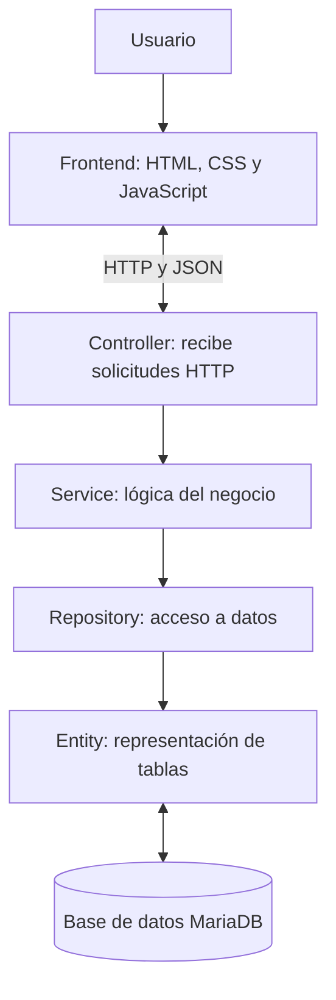

# Arquitectura del sistema CarritoGT

## 1. Descripción general

CarritoGT utiliza una arquitectura cliente-servidor. El usuario interactúa con una tienda web que se comunica con una API REST desarrollada con Java y Spring Boot. La API procesa las solicitudes y utiliza MariaDB para consultar y guardar la información.

## 2. Diagrama de arquitectura

## 3. Función de cada componente

### Frontend

Es la parte visual de la aplicación. Permite consultar los productos, agregarlos al carrito, ver las cantidades y calcular el total. Utiliza JavaScript y `fetch` para comunicarse con la API.

### Controller

Recibe las solicitudes HTTP que llegan a la API y dirige las operaciones al servicio correspondiente. Por ejemplo, `ProductoController` administra las solicitudes relacionadas con los productos y `CarritoController` las del carrito.

### Service

Contiene la lógica del sistema. `ProductoService` permite consultar los productos y `CarritoService` administra las operaciones del carrito, como agregar artículos, incrementar cantidades y eliminar elementos.

### Repository

Permite acceder a la base de datos mediante Spring Data JPA. Los repositorios utilizados son `ProductoRepository` y `CarritoRepository`.

### Entity

Representa las tablas de la base de datos mediante clases Java. `Producto` representa la tabla `producto` y `CarritoItem` representa la tabla `shopping_cart`.

### Base de datos MariaDB

Almacena los productos disponibles y los artículos agregados al carrito de compras.

## 4. Flujo de una solicitud

Cuando el usuario agrega un producto al carrito, el frontend envía una solicitud HTTP con los datos en formato JSON. El controlador recibe la solicitud y llama al servicio. El servicio valida los datos y utiliza el repositorio para consultar o modificar la información en MariaDB. Finalmente, la API devuelve una respuesta que el frontend utiliza para actualizar la interfaz.

## 5. Ventajas de esta arquitectura

- Separa las responsabilidades de cada parte del sistema.
- Facilita el mantenimiento y las modificaciones.
- Permite probar los componentes por separado.
- Facilita la comunicación entre el frontend y el backend mediante HTTP y JSON.
- Permite ampliar las funciones sin concentrar toda la lógica en una sola clase.

## 6. Alcance actual

La aplicación se desarrolla como un sistema monolítico organizado por capas. No utiliza microservicios. Para las pruebas actuales, el backend trabaja con un usuario de prueba fijo y no implementa autenticación de usuarios.
